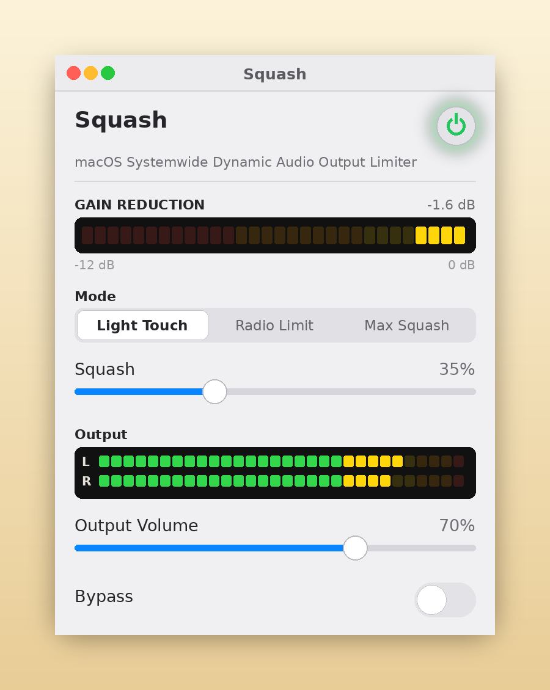
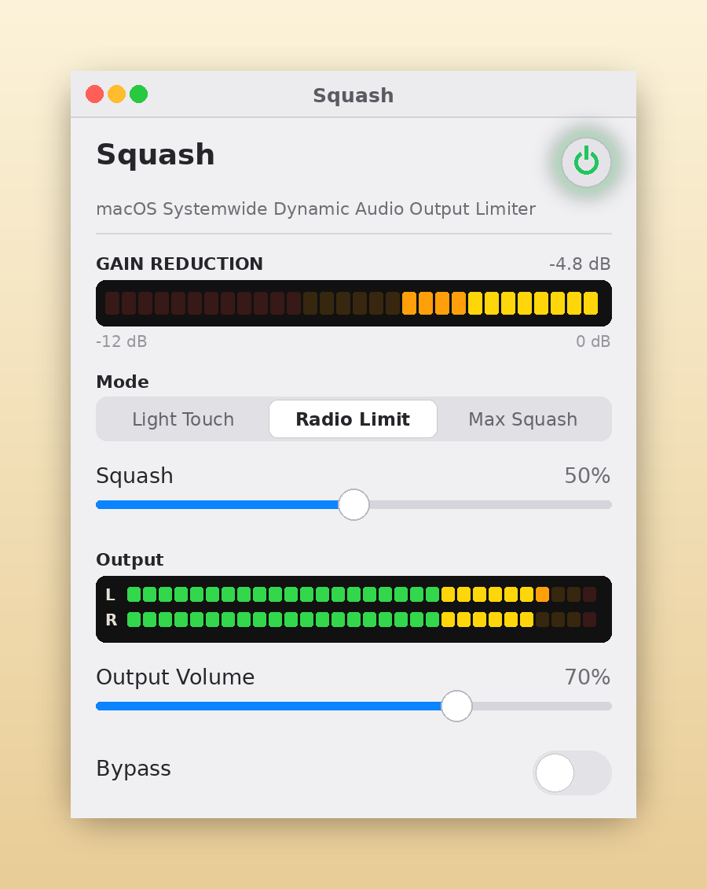
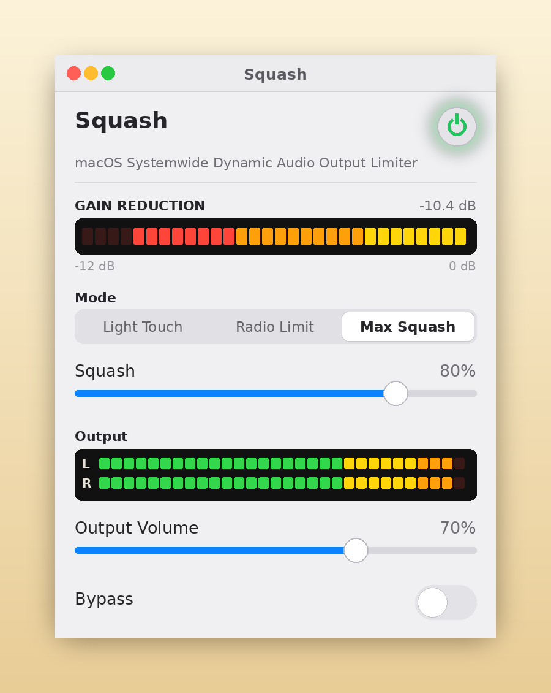

# Squash

**Radio station limiting for internet audio levels**

Squash is a free limiter for your Mac's system audio. It helps control
loud DJs, quiet interviews and blaring station IDs at a steady,
comfortable level — the same trick a broadcast limiter does at the
station, running on your machine instead.

## Download

[**Download Squash.zip**](https://github.com/jgirgus/squash/releases/latest/download/Squash.zip)
(always the latest release)

Requires a Mac on **macOS 14.2 or later**. Runs on Apple Silicon and Intel.

## The three modes

- **Light Touch** — the gentle scheme; even fully clockwise it stays polite.
- **Radio Limit** (default) — smooth, transparent leveling; the tune Squash was built around.
- **Max Squash** — full radio squash; everything lifted toward the same loudness.

## Screenshots

*Light Touch — the gain-reduction meter barely stirs.*

*Radio Limit — the default tune: smooth levelling, output warm and steady.*

*Max Squash — deep reduction, everything lifted to the ceiling.*

## Installing

1. Unzip and drag **Squash** into Applications.
2. Double-click it once — macOS will refuse, because it's from outside
   the App Store. That's expected.
3. Open **System Settings → Privacy & Security** and click **Open Anyway**
   (one time only).
4. Launch Squash, press the power button, and allow audio capture when asked.

Squash processes your Mac's audio on your Mac. Nothing is recorded,
nothing is uploaded. It only works while it's running.

## Freeware

Squash is free to download and free to pass along, provided as-is with
no warranty. If it makes your radio listenable, it did its job.
