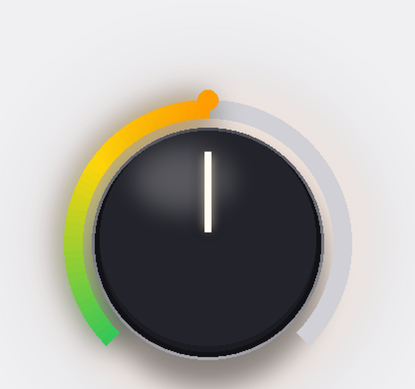
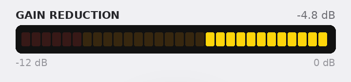
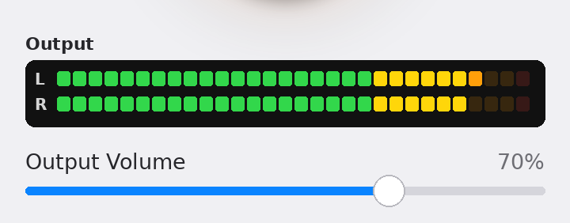
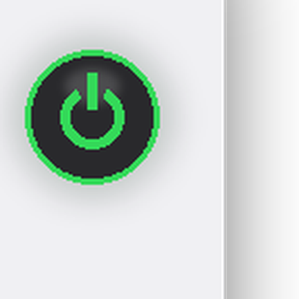

# Squash

**Radio station limiting for internet audio levels**

Squash is a free limiter for your Mac's system audio. It helps control
loud DJs, quiet interviews and blaring station IDs at a steady,
comfortable level — similar to a broadcast limiter at a radio station.
One knob control.

## Download

[**Download Squash.zip**](https://github.com/jgirgus/squash/releases/latest/download/Squash.zip)
(always the latest release)

Requires a Mac on **macOS 14.2 or later**. Runs on Apple Silicon and Intel.

## One knob

- **Radio Limit** — the one scheme, and the one Squash was tuned around: smooth, transparent leveling.
- **A built-in governor** — however far you turn the knob, the leveling can only go so far, and a separate safety limiter catches the peaks.
- **Smooth recovery** — the gain eases back instead of bouncing, so the level never breathes or pumps.

## Screenshot

## A closer look

**The knob** — the only control. Drag up or down to turn it — up means
Squash holds the level steadier. The band's colour shows where it's
set: green at the gentle end, through yellow and orange, to red at
full. It starts at 50%.

**Gain Reduction** — Squash at work. This meter shows how much it's
turning the sound down, moment by moment, to keep the loud parts in
line — squeezing in from the right, like the meter on a broadcast
limiter. Yellow is working, orange is pushing; red is saved for when
it's really leaning on the signal.

**Output** — what actually reaches your ears, left and right, after
Squash. However wild the level gets upstream, this stays steady.
Output Volume below it is just your Mac's volume — the final level,
set here or with the volume keys.

**Power** — Squash starts itself the moment you open it — if the ring
is green, it's running. The button is only there for switching it off,
and the line under the title will remind you how to start it again.

**Bypass** — for comparing. Flip Bypass on and you hear the original
sound, completely untouched; flip it off and Squash steps back in.
It's the quickest way to hear what the app is doing for you.

## Installing

1. Download the zip and open it. Drag **Squash** into your Applications folder.
2. Double-click Squash once. macOS will refuse (it's careful with apps
   from outside the App Store.)
3. Open **System Settings → Privacy & Security**, scroll down, and click
   **Open Anyway**. (You only need to do this once.)
4. Launch Squash — it starts by itself — and allow audio capture when
   asked. (That prompt is the app doing its job.)

Squash processes your Mac's audio on your Mac. Nothing is recorded,
nothing is uploaded, there's nothing to sign up for. It only works while
it's running. Quit and your Mac sound is unchanged.

## Freeware

Squash is freeware: free to download, free to share.
