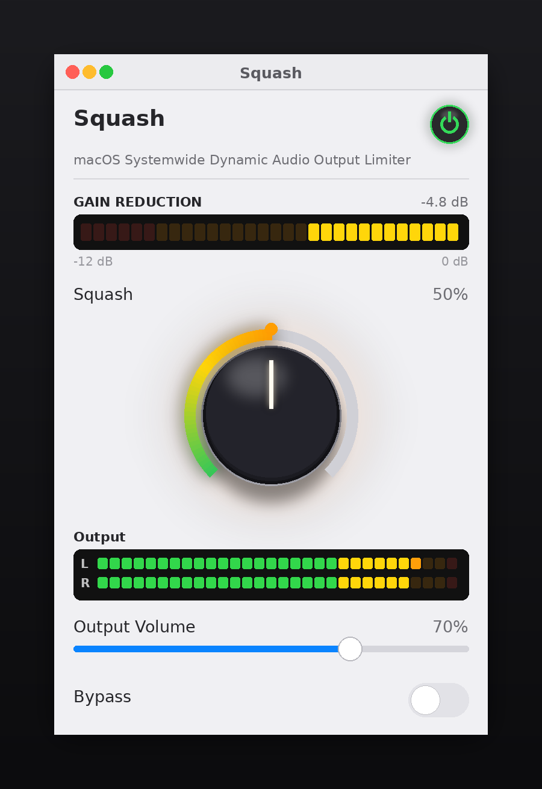

# Squash

**Radio station limiting for internet audio levels**

Squash is a free limiter for your Mac's system audio. It helps control
loud DJs, quiet interviews and blaring station IDs at a steady,
comfortable level — similar to a broadcast limiter at a radio station.
One knob control.

## Download

[**Download Squash.zip**](https://github.com/jgirgus/squash/releases/latest/download/Squash.zip)
(always the latest release)

Requires a Mac on **macOS 14.2 or later**. Runs on Apple Silicon and Intel.

## One knob

- **Radio Limit** — the one scheme, and the one Squash was tuned around: smooth, transparent leveling.
- **A built-in governor** — however far you turn the knob, the leveling can only go so far, and a separate safety limiter catches the peaks.
- **Smooth recovery** — the gain eases back instead of bouncing, so the level never breathes or pumps.

## Screenshot

## Installing

1. Download the zip and open it. Drag **Squash** into your Applications folder.
2. Double-click Squash once. macOS will refuse (it's careful with apps
   from outside the App Store.)
3. Open **System Settings → Privacy & Security**, scroll down, and click
   **Open Anyway**. (You only need to do this once.)
4. Launch Squash — it starts by itself — and allow audio capture when
   asked. (That prompt is the app doing its job.)

Squash processes your Mac's audio on your Mac. Nothing is recorded,
nothing is uploaded, there's nothing to sign up for. It only works while
it's running. Quit and your Mac sound is unchanged.

## Freeware

Squash is freeware: free to download, free to share.
